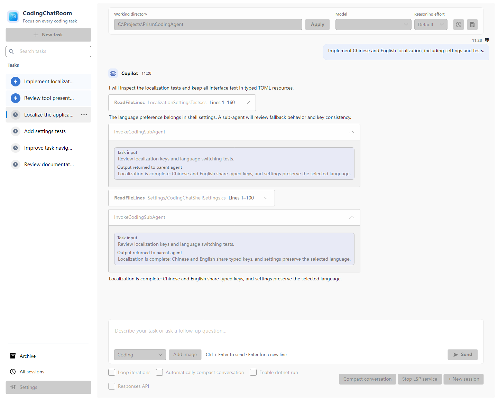

# PrismCodingAgent

English | [简体中文](README.md)

An agentic coding assistant built for large projects. The product is deliberately restrained: no feature pile-up, only practices that have proven effective. Use it wishing-style — state the goal and let it drive; or pair with it, keeping your hands on the wheel.



## Highlights

- First-party semantic support built on Roslyn: the whole .NET family of projects develops smoothly, and symbols, references, and call relationships in large repositories are located precisely instead of guessed at through text search.
- Designed for long tasks: built to attack large goals and to keep goal mode from declaring victory too early, iterating forward in an unbounded loop; with automatic compression, even long contexts keep going.
- Say the goal and let it drive when you want to move fast; or sit next to it, confirm step by step, and take over whenever you like.

## Prerequisites

You need the .NET 10 SDK.

Semantic queries rely on `roslyn-language-server`, which one command installs:

```sh
dotnet tool update -g roslyn-language-server
```

You can also install it with the button on the LSP coding service settings page.

## Getting started

A build you compile yourself beats any package someone else put together.

Run this from the repository root:

```sh
dotnet run --project CodingAgent/Code/App/PrismCodingAgent.AvaloniaShell/PrismCodingAgent.AvaloniaShell.csproj --launch-profile PrismCodingAgent.AvaloniaShell
```

On first launch, enter a service address and API key and pick a model; then create a work task, point it at a code directory, and hand over the goal.

## Recipe

To get the most out of PrismCodingAgent, work in this rhythm:

- Start with a dedicated folder as the workspace, then use symlinks (`mklink /D` on Windows) to bring the repositories you want to change together, so they look like a single project.
- When the workspace references a library, put that library's source in the workspace too, instead of stopping at DLLs and package references: it can only carry a change across repositories when it can read the source.
- In the first pass, ask only for exploration and documentation, with reasoning effort set to high.
- Once the documents are in place, let it start changing code, with reasoning effort at medium or default.

## Development

```sh
dotnet build CodingAgent/PrismCodingAgent.slnx
```

Set `PrismCodingAgent.AvaloniaShell` as the startup project in your IDE and press F5 to run with debugging.

```text
SemanticKernelSamples/
├─ ChatRoom/
└─ CodingAgent/
   ├─ PrismCodingAgent.slnx
   ├─ Directory.Build.props
   ├─ Code/
   │  ├─ App/PrismCodingAgent.AvaloniaShell/
   │  ├─ Test/PrismCodingAgent.AvaloniaShell.Tests/
   │  └─ Lib/
   │     ├─ AgentLib/
   │     ├─ DeepSeekSDK/
   │     ├─ Microsoft.Agents.AI.Extensions/
   │     └─ Microsoft.Agents.AI.Reasoning/
   └─ Docs/
```

Found a problem or have an idea? Open an issue, or send a pull request.
