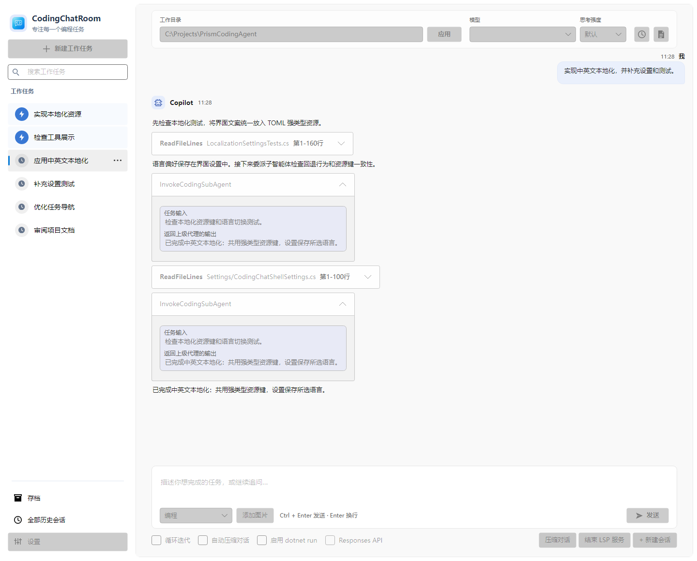

# PrismCodingAgent

[English](README.en.md) | 简体中文

专攻大项目的 CodingAgent 编程助手。产品决策上刻意克制：不堆功能，只保留被实践验证有效的做法。可以许愿式编程——说清目标后交给它自主推进；也可以和它结对，你压着节奏一起干。

这个项目又名「电子丫环」。名字取自一句童谣：小姐小姐别生气，明天带你去看戏，我坐椅子你坐地。原本以为雇了个丫环来帮忙干活，用起来才发现是自己得去伺候这位电子丫环——想让它发挥出全部水平，就得先把工作区安排妥当，还得扛得住过程里被 AI 气上几顿。



## 特点

- 深入 Roslyn 的第一方语义支持，C# 与 .NET 整系项目都能顺畅开发，大仓库里的符号、引用与调用关系定位得准，不靠文本搜索去猜。
- 为长任务设计：专攻大任务，避免目标模式在浅层就宣布结束，用无限循环的方式持续迭代推进；配合自动压缩，上下文再长也能接着干。
- 想省事就一句话许愿，让它自己往前推；想盯紧就坐到它旁边，一步步确认、随时接手。

## 准备工作

需要 .NET 10 SDK。

语义查询依赖 `roslyn-language-server`，执行一条命令装好：

```sh
dotnet tool update -g roslyn-language-server
```

也可以在设置页的「LSP 编程服务」里点按钮一键安装。

## 开始使用

别人打好的包，总不如自己亲手编一份踏实。

在仓库根目录执行：

```sh
dotnet run --project CodingAgent/Code/App/PrismCodingAgent.AvaloniaShell/PrismCodingAgent.AvaloniaShell.csproj --launch-profile PrismCodingAgent.AvaloniaShell
```

首次启动填写服务地址与 API 密钥、选择一个模型；进入主界面后新建工作任务、指定代码目录，就可以把目标交给它了。

## 食用方式

想让它真正发挥作用，建议按这个节奏来：

- 先建一个独立文件夹当工作区，再用符号链接（Windows 上是 `mklink /D`）把要一起改的各个仓库组织进去，让它们看起来像一个项目。
- 工作区里被引用的库，最好把库的源码也放进来，而不是只留 dll 和包引用：它读得到源码，才改得动跨库的代码。
- 第一阶段只让它探索和写文档，这时把思考强度调到高。
- 文档成型之后再让它动手改代码，这时思考强度用中或默认就够。

## 开发

```sh
dotnet build CodingAgent/PrismCodingAgent.slnx
```

在 IDE 里把 `PrismCodingAgent.AvaloniaShell` 设为启动项目，按 F5 就能带调试运行。

```text
SemanticKernelSamples/
├─ ChatRoom/
└─ CodingAgent/
   ├─ PrismCodingAgent.slnx
   ├─ Directory.Build.props
   ├─ Code/
   │  ├─ App/PrismCodingAgent.AvaloniaShell/
   │  ├─ Test/PrismCodingAgent.AvaloniaShell.Tests/
   │  └─ Lib/
   │     ├─ AgentLib/
   │     ├─ DeepSeekSDK/
   │     ├─ Microsoft.Agents.AI.Extensions/
   │     └─ Microsoft.Agents.AI.Reasoning/
   └─ Docs/
```

遇到问题或者有想法，欢迎提 Issue，也欢迎直接 PR。
